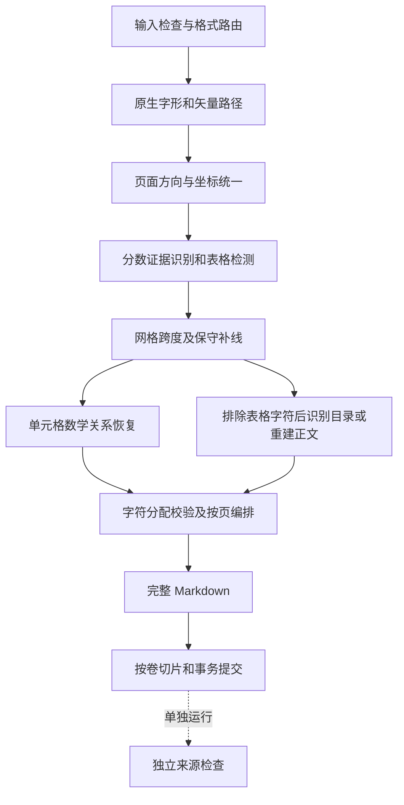

# 算法数据流与模块

## 设计目标

用可核验的来源关系恢复文档结构，提供可读 Markdown、机器可解析的语义结构和原图依据。数字、单位和公式的处理以来源字形和几何为依据，不依靠语言模型补写。运行成功、字符守恒和语义正确分别判断。

## 模块职责

| 模块 | 输入及处理 | 输出及约束 |
|---|---|---|
| `converter.py` / `cli.py` | 输入类型、输出、依赖与参数检查；计算来源哈希，暂存产物 | Python API、CLI、来源副本和带回滚的提交；默认不覆盖 |
| `pdf_document.py` | 读取页面，统一方向；组织正文、表格、页图与 OCR 候选 | 连续物理页锚；逐页字符分配计数与审计 |
| `pdf_tables.py` | 字形 ID、位置、基线、字号、源块及行；原始网格和绘图路径 | 单元格、跨度、补线证据、表格图与正文段落 |
| `printed_toc.py` | 物理基线行；重复引导线及页码边界；可见字形缩进与编号深度 | 与 PDF 文本块顺序无关的目录条目、栏序、页码配对、层级与来源字段 |
| `glyph_layout.py` | 按局部基线聚类，校准 CJK 字号；结合字号、位移和邻近度绑定完整脚标串 | `scripts`、`script_parts`、可读文字和线性语义；歧义进入 review |
| `body_script_layout.py` | 在已重建段落中验证脚标绑定与文字顺序 | 不改变既有顺序的正文语义 HTML |
| `fraction_layout.py` | 矢量分数线、完整数字、字号、居中和距离证据；分数原子化 | `(5/9)` / `(1+1/2)`；派生标点与原字形分开记录 |
| `units.py` | 已知单位符号、乘除、括号、幂次的保守语法解析 | 可见单位、ASCII 表达与 AST；不做数值或单位换算 |
| `volumes.py` | 已完成全文的页锚与印刷卷标题；排除目录 | 按完整页切片，校验原片段拼回全文，修正附件及跨卷链接 |
| `fidelity.py` | 重新读取原 PDF、落盘 Markdown 和已有图像 | 字符、区域、顺序和图像检查；结构记录仅为分区建议 |
| `script_witness.py` / `math_witness.py` | 从实际 HTML 解读声明，再独立核对原 PDF 字形和线条 | 验证主体、方向、坐标、分数及派生符号；提供脚标线性化 |
| `table_refresh.py` | 来源哈希匹配的旧结果、原 PDF 和结构记录 | 安全刷新单元格/正文脚标并同步分卷；不确定时拒绝局部提交 |
| `formats.py` | DOCX、PPTX、XLSX、HTML 专用适配器 | 保留这些输入已有的基础结构，不套用 PDF 的几何保证 |

## 正文和表格采用不同的组装策略

正文保留原生中英数字混排顺序，通过基线变化和向左回行拆出物理行，再按缩进、条目、标题、行距和表格边界合并段落。小字体本身不代表上下标。图注先组完整，再放在相邻完整段落之间；中文物理换行不自动成为段落。

表格先确定单元格和跨度，再在局部重建文字。补线要求多个竖线端点和跨列上下文字共同支持，不能仅凭单元格文字换行推断行界。确认的分数线不参与网格检测；补线不能穿过完整分数。非矩形分区或模型冲突降级为原图与来源文字，保留待复核状态。

## 印刷目录的空间重建

目录不再使用“一个 PDF 文本块就是一个目录条目”的假设。先用基线将碎片归入物理行，再按横坐标配对标题、引导点和印刷页码。重复的页码右边界建立列区域，随后按栏从左到右、栏内从上到下排列，避免相邻两栏交叉串读。明确目录标题允许无引导线但有充分间距的页码；无标题的续页需要至少四组引导线与页码证据。

跨行标题仅在行距、列区域及编号/标题证据相容时合并。缩进采用首个可见字形的位置，不采用包含前导空白的文本框左边界；物理缩进步长结合章节编号推断，避免续页缺少中间层级时把三级条目压成二级。章、节编号只提供层级证据，不参与补写内容。

输出为 Markdown 内嵌的两列表格，保留层级缩进和原书页码。完整引导字符作为装饰来源数据保存，显示时用紧凑省略号。条目字段分别记录来源字形 ID 和区域框；目录标题内仍执行脚标语义恢复。无法配对的片段保留并进入 review，识别证据不足则回到普通正文路径。

独立检查器从原 PDF 重读各字段，检查标题/页码内容、同基线关系、左右关系、栏序、层级声明及脚标绑定；对装饰数据只允许引导点和空白。调换两个页码，即使全页字符总量不变，也会报告条目差异。印刷目录的专用标记同时阻止后续分卷将目录里的卷名当成卷首。

## 数学语义与来源守恒

脚标记录主体、角色、完整内容、左右关系、嵌套父节点和原字形框。数字显示为 Unicode 上下标，字母/混合串使用语义 HTML；带圈脚注单列 annotation。公差、小数和不确定主体受到保护或进入复核。

数字分数仅接受矢量线与原数字共同支持的结构，拒绝从完整数值中截取局部数字。括号、斜杠及带分数加号标为派生语法。单位 AST 描述印刷符号中的运算关系，不执行单位换算。

内部字符分配按全部分配次数检查正文和单元格之间的遗漏及重复。独立检查器再检查落盘结果，可发现字符总数不变的单元格互换、脚标改绑或图片变化。字符守恒无法独自证明复杂阅读顺序或公式语义，风险保留为 review。

## 输出和稳定性

每个 PDF 包包含全文、来源副本、表格图、逐页结构和审计；按需包含页图、OCR 候选和分卷。没有明确卷标题时只保留全文。分卷不再次解析或改写正文。卷号歧义、页锚缺失和字符分配异常明确失败。

同一输出包使用暂存、备份、重命名提交和异常回滚；Windows 卷目录句柄受占用时可逐个备份生成文件。该机制处理可捕获的写入异常，不是跨进程锁，也不是断电恢复保证。同一目标串行写入。
